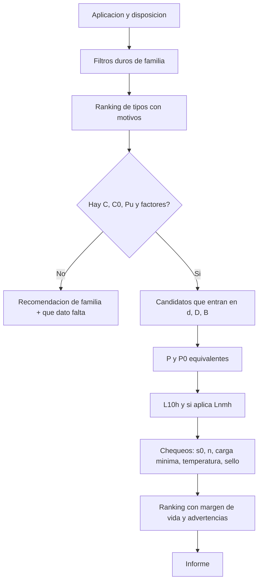

# CALIBRE — Plan de ingeniería para un selector profesional de rodamientos

Documento de contexto para un agente de implementación (Antigravity u otro).
Léelo completo antes de escribir código. No es un briefing de marketing: es el contrato técnico.

| Campo | Valor |
|---|---|
| Producto | **CALIBRE** (nombre de trabajo; se puede renombrar) |
| Promesa | Elegir el tipo y el tamaño de rodamiento correctos a partir de las variables reales de la máquina, con cálculo auditable |
| Idioma de la UI | Español (Argentina). Identificadores de código en inglés |
| Fuente de ingeniería | Catálogo general SKF *Rodamientos* (edición en español analizada, ~1266 páginas) + normas ISO que ese catálogo aplica |
| Mapeo de páginas | En ese PDF, `página de catálogo ≈ página PDF + 19`. Ej.: catálogo p. 64 = PDF p. 45 |
| Qué no es | No es el calculador oficial de SKF, no vende piezas SKF y no reproduce el catálogo |

---

## 0. Instrucciones para el agente

### Rol

Sos el ingeniero que construye CALIBRE. El cálculo manda. La interfaz explica el cálculo. Si un número no sale de una fórmula de este documento o de un dato cargado, no se muestra.

### Orden obligatorio

1. Motor de cálculo puro, sin UI, con tests dorados de la sección 12.
2. Modelo de datos y catálogo semilla (sección 8). No scrapear el PDF entero.
3. Motor de reglas de selección (sección 6 y 7).
4. UI del wizard, resultado, comparación e informe.
5. Recién después: ciclo de carga, ayudas de correa/engranaje, disposiciones de eje, ajustes, vida de grasa.

### Definición de hecho (v1)

- Un usuario con `d`, `Fr`, `Fa`, `n`, vida requerida y ambiente obtiene una shortlist rankeada, con motivos de aceptación y de descarte.
- La vida `L10h` y `Lnmh` coincide con los tests dorados.
- Cada recomendación muestra supuestos, fórmula usada y advertencias.
- El informe deja claro que es una ayuda de ingeniería, no una certificación.
- No hay logo, colores corporativos ni claim de “resultado SKF oficial”.

### Prohibido

- Inventar capacidades de carga `C`, `C0`, `Pu`, factores `e`, `Y`, `f0`, `kr` o velocidades. Si no están en el registro del rodamiento, el candidato no entra al ranking numérico: se ofrece el tipo y se pide el dato, o queda en modo “solo orientación de familia”.
- Poner un LLM en el camino del número. Un modelo de lenguaje puede redactar la explicación **después**, citando únicamente salidas del motor.
- Copiar las tablas de producto del catálogo (designación + `C` + `C0` + `Pu` + velocidades de miles de ítems) a una base embebida. Eso es material con copyright del fabricante. Ver sección 2.
- Usar `aSKF` leído “a ojo” de los diagramas sin una tabla digitalizada y testeada. Hasta entonces, calcular y etiquetar solo vida nominal básica ISO (`aSKF = 1`) y mostrar “vida modificada no disponible”.
- Redondear de más en el motor. Redondear solo en la UI (vida en horas a entero, cargas a 3 cifras significativas, factores a 2–3 decimales).
- Tratar el eje como flexible, con momentos de vuelco reales o con reparto de carga entre hileras, en la v1. El catálogo (p. 84) calcula cada apoyo como soporte rígido sin momento. Hay que decirlo en pantalla.

### Criterio de duda

Si una fórmula de este plan y el catálogo discrepan, gana el catálogo y se corrige el código. Los puntos marcados `VERIFICAR EN CATÁLOGO` no se hardcodean hasta leer esa página.

---

## 1. Producto

### Para quién

Taller de ingeniería, mantenimiento industrial y diseñadores de máquinas en Latinoamérica que hoy eligen “de memoria” un 6205 o copian el repuesto sin recalcular vida, carga axial ni contaminación.

Dos modos, misma física:

1. **Seleccionar.** No sabe el tipo. Responde variables de la aplicación. Recibe familias rankeadas y, si hay catálogo, tamaños que cumplen.
2. **Verificar.** Ya tiene una designación o un rodamiento del almacén. Carga cargas, velocidad y ambiente. Recibe vida, seguridad estática, velocidad, carga mínima y si sirve o no.

### Por qué se siente premium

No por animaciones. Por esto:

- El esquema del eje se dibuja con los dos apoyos, el lado fijo y el lado libre, y se actualiza con los datos.
- Cada descarte tiene una frase de ingeniería (“la desalineación estimada supera lo que admite un rígido de bolas; hace falta rótula o CARB”), no un score opaco.
- El informe es imprimible y defendible frente a un cliente: entradas, normas, resultados, márgenes, lo que no se calculó.
- Los números son monoespaciados y tabulados. La vida se ve como magnitud, no como badge.
- Hay comparación lado a lado de hasta 3 candidatos.
- El vacío, el error y la incertidumbre están diseñados: “falta `Pu`, no puedo calcular `aSKF`” es una pantalla válida, no un hueco.

### Nombre y marca

Nombre de trabajo: **CALIBRE**. Alternativas si está tomado: **ORBE**, **EJE NORTE**, **NORMA**.

No usar azul SKF `#004B93` ni el rojo de su logo. Paleta propia de instrumento de medición:

- Fondo carbón `#121614`
- Superficie `#1C2420`
- Texto `#F3F0E7`
- Texto secundario `#A8B0A6`
- Acento cobre `#D7A15E` (un solo acento)
- Peligro `#E15A45`
- OK `#7DAB6A`
- Papel del informe `#F6F3EC` con texto `#1A1A17`

Tipografía: una sans técnica con números tabulares (IBM Plex Sans o Geist) y una mono para designaciones y resultados (IBM Plex Mono). No Inter genérico, no gradientes, no glassmorphism, no ilustraciones 3D de stock.

Croquis de rodamientos: SVG geométricos propios, de sección. No fotografías del catálogo.

### Alcance por versiones

| Versión | Incluye | No incluye |
|---|---|---|
| **v1 — Selector honesto** | Wizard, reglas de familia, vida ISO `L10`/`L10h`, carga equivalente de las familias con factores cargados, estática `s0`, velocidad de catálogo, carga mínima de regla general, ciclo de carga, informe, catálogo semilla + alta manual | `aSKF` real, ajustes ISO completos, vida de grasa, engranajes, pares de cónicos |
| **v1.1 — Vida de catálogo** | `κ`, `ηc` por ecuación, `aSKF` por curvas digitalizadas, clase Explorer vs estándar, aditivos EP | Diagramas de fricción SKF |
| **v2 — Disposición** | Eje de 2 apoyos, lado fijo/libre, reacciones por estática, correa, par de contacto angular o cónico, precarga solo como advertencia | Elementos finitos |
| **v3 — Proyecto** | Proyectos guardados, varias posiciones de eje, comparación, sensibilidad (qué pasa si la carga sube 20%), exportación | Cuentas multiusuario solo si se piden |

La v1 ya tiene que ser usable en un caso real de eje con dos rodamientos rígidos de bolas o un rígido + un libre. No entregues un formulario suelto sin el esquema ni el porqué.

---

## 2. Propiedad intelectual y responsabilidad

El catálogo es material del fabricante. La metodología de vida de la norma **ISO 281** y la capacidad estática de **ISO 76** son normas (hay que respetar la licencia de la norma si se cita textual extensamente; las ecuaciones de este plan son las necesarias para implementar el método).

### Permitido

- Implementar las ecuaciones de las secciones 5 y 6, que son el método ISO / el método publicado de selección.
- Codificar reglas cualitativas de selección (qué familia admite radial, axial, desalineación, lado libre).
- Pedir al usuario que ingrese `C`, `C0`, `Pu`, `n_ref`, `n_lim` desde su catálogo o planilla.
- Importar un CSV propio del usuario.
- Un catálogo semilla **pequeño y marcado `source: "sample"`**, con pocos tamaños de series muy usadas, solo para que la demo calcule. En UI: “Datos de muestra para cálculo. Confirmá contra el catálogo del fabricante antes de comprar o mecanizar.”
- Decodificar la **estructura** de la designación (sección 9). Decodificar no exige listar todo el catálogo.

### No permitido

- Volcar por OCR las tablas de producto del PDF a producción.
- Decir “recomendado por SKF”, usar su logo o copiar sus figuras.
- Presentar la vida modificada como idéntica a SKF Bearing Select si las curvas de `aSKF` no fueron digitalizadas y contrastadas.

### Pie de informe, siempre visible

> CALIBRE es una ayuda de cálculo. No reemplaza el criterio del fabricante ni un análisis de la máquina completa. La vida nominal es una estimación estadística de fatiga del camino de rodadura (90% de confiabilidad en `L10`), no una garantía. No cubre por sí sola fallas por montaje, corrosión, ajuste incorrecto, jaula, sello o lubricante inadecuado. Verificá designación, capacidades y factores en el catálogo vigente antes de fabricar o comprar.

---

## 3. Qué decide un rodamiento (modelo mental)

Un rodamiento no se elige por la designación. Se elige en este orden, que es el del catálogo (secciones A y B):

1. **Qué tiene que hacer la disposición:** lado fijo (ubica el eje en los dos sentidos) y lado libre (deja dilatar). Catálogo p. 55.
2. **Tipo**, según espacio, dirección y magnitud de carga, desalineación, precisión, velocidad, fricción, ruido, rigidez, desmontaje y sello. Catálogo p. 46–59.
3. **Tamaño**, según vida ISO 281 y, por separado, según carga estática ISO 76. Catálogo p. 63–89.
4. **Variante:** juego, sello, jaula, agujero cónico, clase de precisión, estabilización térmica.
5. **Entorno del sistema:** ajustes, lubricante, contaminación, temperatura. El rodamiento solo no cierra el diseño.

La app debe poder parar en el paso 2 con una recomendación de familia útil aunque todavía no haya base de datos grande. El paso 3 numérico solo corre con datos de capacidad reales.



---

## 4. Familias que el motor conoce

Cada familia es un módulo de carga equivalente con la misma interfaz. No un `if` gigante en la UI.

```ts
type LoadResult = {
  P: number          // kN, dinámica equivalente
  P0: number         // kN, estática equivalente
  warnings: string[]
  rejected?: string  // si la familia no puede con esa carga
}

interface LoadModel {
  family: BearingFamily
  equivalent(input: LoadInput, bearing: Bearing): LoadResult
}
```

### 4.1 Matriz de admisión

Valores cualitativos del capítulo “Criterios básicos de selección” (catálogo p. 46–59) y de los capítulos de producto. Donde el catálogo manda a “ver capítulo”, la celda dice el orden de magnitud y `VERIFICAR`.

| Familia | Radial | Axial | Momento | Desalineación | Velocidad | Rigidez | Lado libre interno | Notas de selección |
|---|---|---|---|---|---|---|---|---|
| Rígido de bolas, 1 hilera (6) | Normal | Moderada, los dos sentidos. Pura: `Fa ≤ 0,5 C0`; series chicas o livianas `Fa ≤ 0,25 C0` | Baja | 2 a 10 min de arco | Muy alta | Baja | No. El aro libre va con ajuste holgado | Default de eje chico, motores, ruido bajo. Hay variante silenciosa |
| Rígido de bolas, 2 hileras (4) | Mayor que 1 hilera | Sí, con `e` | Mejor que 1 hilera | ≤ 2 min | Alta | Media | No | Más rigidez, menos desalineación |
| Contacto angular, 1 hilera (72, 73) | Combinada | Alta, **un solo sentido** | Baja suelto | Muy baja | Alta | Media-alta | No | Axial que cambia de sentido: par universal DB/DF |
| 4 puntos (QJ) | Radial limitada si se lo usa como axial puro | Alta, los dos sentidos | Baja | Baja | Media-alta | Media | Aro exterior con juego radial si va descargado de radial | Segundo rodamiento axial cuando el axial de la combinada es grande |
| Bolas a rótula (1) | Normal | Limitada | Baja | Alta (típ. ~2–3°, `VERIFICAR`) | Alta | Baja | No | Ejes que flexionan, cargas no muy altas |
| Rodillos cilíndricos NU, N | **Solo radial** | No | No | Pocos minutos | Alta | Alta | **Sí**, el desplazamiento es interno | Lado libre clásico |
| NJ | Radial | Axial limitada, un sentido | No | Pocos minutos | Alta | Alta | Parcial | `Fa` chica respecto de `Fr` |
| NUP | Radial | Axial limitada, dos sentidos | No | Pocos minutos | Alta | Alta | Parcial | Puede hacer de fijo con axial chica |
| Agujas | Radial alta en poco espacio radial | En general no | No | Muy baja | Media | Alta | Según diseño | Si `D` está muy limitado |
| Cónicos, 1 hilera (3) | Combinada alta | Alta, **un sentido** | Alto en par espalda-espalda | Muy baja; hay que alinear | Media | Muy alta | No | Siempre pensar el par y la carga axial inducida |
| Rodillos a rótula (2) | Muy alta | Alta, los dos sentidos | Media | Alta (típ. hasta ~1,5–2°, `VERIFICAR` por serie; sellados menos) | Media | Media | No, salvo aro libre | Cargas pesadas + flexión de eje. Funcionan más calientes |
| CARB | **Solo radial**, muy alta | No | No | Alta y, además, **desplazamiento axial interno** | Media | Media | **Sí**, el mejor libre si hay desalineación y dilatación | No lo cargues axial |
| Axial de bolas, simple efecto (511–514) | No (o despreciable) | Pura, **un sentido**, centrada | No | No, salvo arandela esférica de asiento para error de mecanizado | Baja vs radial | — | No aplica | `n` alto lo descarta rápido |
| Axial de bolas, doble efecto | No | Pura, dos sentidos | No | Igual que arriba | Baja | — | No aplica | |
| Axial de rodillos a rótula | Admite radial si no domina | Muy alta, un sentido | Baja | Alta | Baja-media | — | No | `s0 ≥ 4`. Para axial alterno, dos unidades |
| Y / inserción | Como un rígido | Moderada | Baja | Compensa error inicial de montaje | Media | Baja | Según soporte | Ejes de transportador, soportes de pie. Fase posterior |
| Roldanas, levas | Radial de leva | Según tipo | — | Según tipo | Según tipo | — | — | Fuera de v1 |

Reglas duras, en este orden:

1. Si la carga es **solo radial** y hace falta **dilatación dentro del rodamiento**: NU, N, agujas, o CARB si además hay desalineación. Un rígido de bolas solo puede ser libre si **un aro** tiene ajuste holgado.
2. Si la desalineación esperada es mayor que unos minutos y el tipo es rígido (rígido de bolas o cilíndrico): descartar, salvo que el usuario acepte bajar la vida y el ruido. Ofrecer rótula, CARB o axial de rodillos a rótula.
3. Si `Fa` cambia de sentido y el tipo solo admite un sentido (contacto angular suelto, cónico suelto, axial simple, NJ): no es solución única. Proponer par DB/DF o el tipo de dos sentidos.
4. Si el axial es puro y alto a velocidad baja o moderada: axiales. Si el axial es puro y la velocidad es alta: contacto angular, no axial de bolas.
5. Si el espacio radial es el límite (`D` chico para el `d`): series de diámetro 8 o 9, agujas, o rígidos de sección baja. Si el espacio axial es el límite: series angostas, cilíndricos, o combinados de agujas.
6. Si `d` es chico y la carga es normal: priorizar rígido de bolas. Si `d` es grande y la carga es pesada: rodillos.
7. Rodillos completamente llenos: más carga, menos velocidad. No son el default.
8. Ruido crítico (electrodoméstico, oficina): rígido de bolas, variante silenciosa si existe; evitar rodillos.
9. Rigidez crítica (engranaje, husillo): cilíndricos o cónicos, y decir que la precarga sube rigidez pero **no** calcular precarga en v1: advertir y mandar a especialista.
10. Desmontaje frecuente o interferencia en los dos aros: preferir desarmables (cilíndricos, cónicos, QJ, axiales) o agujero cónico 1:12 con manguito.
11. Contaminación o “sin mantenimiento”: preferir tapados. Sellados de ambos lados: grasa de por vida, no relubricar. Los de contacto bajan la velocidad límite.
12. Temperatura por encima de 120 °C: no alcanza el rodamiento estándar (estabilizado al menos a 120 °C en rígidos). Pedir clase S0…S4 y revisar jaula, sello y grasa.

### 4.2 Lado fijo y lado libre

Toda disposición de eje que la app dibuje tiene exactamente una de estas intenciones por apoyo:

- `fixed`: tiene que tomar axial en los dos sentidos, solo o en combinación con otro.
- `floating`: tiene que dejar crecer el eje. O el rodamiento lo permite adentro (NU, N, CARB), o un aro va holgado.
- `axial-only`: toma el axial y se monta con juego radial para no tomar radial (típico QJ o rígido usado como segundo apoyo axial).

Default que la app propone, y el usuario puede cambiar:

| Situación | Fijo | Libre |
|---|---|---|
| Eje corto, carga combinada moderada, bien alineado | Rígido de bolas | Rígido de bolas con aro exterior holgado |
| Carga radial alta, alineado, dilatación | Cilíndrico con pestañas (NUP o NJ+HJ) o par de cónicos / contacto angular | NU o N |
| Carga alta y el eje flexiona | Rodillos a rótula | CARB |
| Axial fuerte en los dos sentidos + radial en otro apoyo | QJ o rígido con juego radial | El radial (NU, N, rótula, CARB) |
| Cónico o contacto angular de un sentido | Par espalda con espalda (DB) | Según la dilatación; a menudo el par es el fijo y hay un libre aparte |

El esquema SVG muestra el eje, los dos apoyos, la flecha de `Fr` y `Fa`, y la cota de dilatación en el libre. Si el usuario pone dos “fijos” no desarmables con ajuste apretado en ambos aros, la app advierte: la dilatación térmica se convierte en carga axial inducida y la vida calculada deja de ser válida.

---

## 5. Motor de cálculo

Unidades internas, siempre: milímetros, kilonewton, revoluciones por minuto, horas, grados Celsius, mm²/s. Convertir en los bordes de la UI.

### 5.1 Vida nominal básica — ISO 281

Catálogo p. 64.

$$
L_{10} = \left(\frac{C}{P}\right)^{p}
$$

$$
L_{10h} = \frac{10^{6}}{60\,n}\,L_{10}
$$

| Símbolo | Significado | Unidad |
|---|---|---|
| `L10` | Vida nominal básica, 90% de confiabilidad | millones de revoluciones |
| `L10h` | La misma vida | horas |
| `C` | Capacidad de carga dinámica básica | kN |
| `P` | Carga dinámica equivalente | kN |
| `n` | Velocidad | r.p.m. |
| `p` | 3 en bolas, 10/3 en rodillos | — |

Inversa, para buscar tamaño con `a1 = 1` y `aSKF = 1`:

$$
L_{10,\text{req}} = \frac{60\,n\,L_{h,\text{req}}}{10^{6}}
$$

$$
C_{\text{req}} = P \cdot \left(L_{10,\text{req}}\right)^{1/p}
$$

Si `n ≤ 0` o el movimiento es oscilante lento (`n < 10` r.p.m. sostenido): no uses la vida como criterio principal. Pasá a sección 5.6. Si `P ≤ 0`: error de entrada.

`C` del catálogo vale para acero al cromo templado a mínimo 58 HRC, carga constante en magnitud y dirección, radial en radiales y axial centrada en axiales. Los Explorer ya traen el `C` ajustado: usar el `C` publicado, no inflarlo otra vez.

### 5.2 Vida nominal modificada

Catálogo p. 65.

$$
L_{nm} = a_{1}\,a_{\text{SKF}}\,L_{10}
$$

$$
L_{nmh} = \frac{10^{6}}{60\,n}\,L_{nm}
$$

#### Factor `a1` (tabla 1 del catálogo, ISO 281)

| Confiabilidad | Probabilidad de falla | Vida | `a1` |
|---|---|---|---|
| 90% | 10% | `L10m` | 1 |
| 95% | 5% | `L5m` | 0,64 |
| 96% | 4% | `L4m` | 0,55 |
| 97% | 3% | `L3m` | 0,47 |
| 98% | 2% | `L2m` | 0,37 |
| 99% | 1% | `L1m` | 0,25 |

No extrapolar por encima de 99% ni por debajo de 90%.

#### Factor `aSKF`

Depende de:

- familia de diagrama: radial de bolas, radial de rodillos, axial de bolas, axial de rodillos
- clase: estándar u Explorer (escalas distintas del mismo diagrama)
- relación de viscosidad `κ` (en el catálogo en español figura como `k`; en código usar `kappa`)
- contaminación `ηc`
- relación `Pu / P`

Límites que el catálogo sí escribe en texto:

- No tiene sentido usar `aSKF > 50` aunque el diagrama siga. **Cap a 50.**
- Cuando `ηc · (Pu / P)` tiende a 0, `aSKF` tiende a **0,1** para cualquier `κ`.
- Si `κ > 4`, usar la curva `κ = 4`.
- **Aditivos EP** (catálogo p. 73): si `κ < 1` y `ηc ≥ 0,2` y el lubricante tiene EP de eficacia comprobada, recalcular con `κ = 1`, pero el `aSKF` de ese recálculo se limita a **≤ 3** y nunca puede quedar **por debajo** del `aSKF` calculado con el `κ` real.

Implementación aceptada, en este orden:

1. Mientras no existan curvas: `aSKF = 1`, etiqueta `basic-iso`, y la UI dice “sin factor de lubricación ni contaminación”.
2. Curvas digitalizadas de los diagramas 1 a 4 (catálogo p. 66–69): tabla `{diagram, performance, kappa, x: ηc·Pu/P, y: aSKF}` con interpolación log-log. Tests de humo: un punto conocido del catálogo (sección 12.6) tiene que caer cerca.
3. No inventar los coeficientes cerrados de ISO 281. Si más adelante se transcriben **desde la norma**, se comparan contra los diagramas y se reemplaza la tabla. Hasta esa comparación, la tabla manda.

`Pu` sale de la tabla del rodamiento. No aproximar `Pu` como fracción de `C` salvo un modo explícito `rough` que la UI marque como no apto para informe.

### 5.3 Viscosidad y `κ`

Catálogo p. 71–73.

$$
\kappa = \frac{\nu}{\nu_{1}}
$$

- `ν`: viscosidad real del lubricante a la temperatura de funcionamiento, mm²/s.
- `ν1`: viscosidad que el rodamiento necesita a esa temperatura, según `dm` y `n`.
- `dm = 0,5 (d + D)` mm.

`ν1` se lee del diagrama 5 (catálogo p. 72). **No uses una fórmula de memoria sin validarla.** Punto de calibración obligatorio:

- `d = 340`, `D = 420`, `n = 500`, `dm = 380` → `ν1 ≈ 11` mm²/s.
- A 70 °C de funcionamiento, ese caso pide un aceite **ISO VG 32** (viscosidad ≥ 32 mm²/s a 40 °C).

Hasta calibrar el diagrama, el usuario puede ingresar `ν` y `ν1` a mano, o ingresar el grado ISO VG y la temperatura si ya está calibrada la curva temperatura-viscosidad.

#### Grados ISO VG a 40 °C (ISO 3448, tabla 3 del catálogo)

| Grado | Media | Mín | Máx |
|---|---|---|---|
| 2 | 2,2 | 1,98 | 2,42 |
| 3 | 3,2 | 2,88 | 3,52 |
| 5 | 4,6 | 4,14 | 5,06 |
| 7 | 6,8 | 6,12 | 7,48 |
| 10 | 10 | 9,0 | 11,0 |
| 15 | 15 | 13,5 | 16,5 |
| 22 | 22 | 19,8 | 24,2 |
| 32 | 32 | 28,8 | 35,2 |
| 46 | 46 | 41,4 | 50,6 |
| 68 | 68 | 61,2 | 74,8 |
| 100 | 100 | 90 | 110 |
| 150 | 150 | 135 | 165 |
| 220 | 220 | 198 | 242 |
| 320 | 320 | 288 | 352 |
| 460 | 460 | 414 | 506 |
| 680 | 680 | 612 | 748 |
| 1000 | 1000 | 900 | 1100 |
| 1500 | 1500 | 1350 | 1650 |

Diagrama 6: aceites minerales, índice de viscosidad 95. Implementar con la ecuación de Walther (ASTM D341) **ajustada** para que VG 32 a 70 °C coincida con el diagrama, no con un exponente inventado. Rótulas, cónicos y axiales de rodillos a rótula suelen ir más calientes que un rígido o un cilíndrico a igualdad de condiciones: si el usuario no midió temperatura, la app propone una temperatura distinta por familia y lo dice.

Si `κ < 1`: advertencia de película insuficiente. Si `κ > 4`: buen margen, pero no seguir subiendo `aSKF` por encima de la curva 4.

### 5.4 Contaminación `ηc`

Dos capas. La primera alcanza para v1. La segunda es la ecuación del catálogo.

#### Capa A — orientación (tabla 4, catálogo p. 74)

Solo contaminante sólido. Agua y fluidos agresivos no entran en `ηc` y se advierten aparte: pueden dominar la falla.

| Condición | `dm < 100` | `dm ≥ 100` | Típico |
|---|---|---|---|
| Limpieza extrema | 1 | 1 | Partícula del orden del espesor de película, laboratorio |
| Gran limpieza | 0,8–0,6 | 0,9–0,8 | Filtro muy fino, o sellado engrasado de por vida |
| Limpieza normal | 0,6–0,5 | 0,8–0,6 | Filtro fino, o placas de protección y grasa de por vida |
| Contaminación ligera | 0,5–0,3 | 0,6–0,4 | Sin sello integral, filtro grueso, algo de desgaste |
| Contaminación típica | 0,3–0,1 | 0,4–0,2 | Sin sello, ingreso desde afuera |
| Contaminación severa | 0,1–0 | 0,1–0 | Sellos dañados, desgaste fuerte |
| Muy severa | 0 | 0 | Fuera de escala. La vida real puede ser mucho peor que la nominal |

En la UI, si el rango tiene dos números, default el punto medio y mostrar el intervalo como incertidumbre (“la vida podría moverse entre X e Y”). Si `ηc = 0`, no informes una vida larga: informe de “la fatiga deja de ser el modo que manda; hay desgaste abrasivo”.

#### Capa B — ecuación (catálogo p. 77)

Cuando hay código de limpieza o nivel de grasa:

$$
\eta_{c} = \min\left(c_{1}\,\kappa^{0,68}\,d_{m}^{0,55},\; 1\right) \left[1 - \frac{c_{2}}{3\sqrt{d_{m}}}\right]
$$

Si el corchete da negativo, `ηc = 0`. Resultado siempre en `[0, 1]`.

**Grasa (tabla 6):**

| Nivel | `c1` | `c2` |
|---|---|---|
| Gran limpieza | 0,0864 | 0,6796 |
| Limpieza normal | 0,0432 | 1,141 |
| Leve a típica | 0,0177 | 1,887 (si `dm ≥ 500`, usar 1,677) |
| Severa | 0,0115 | 2,662 |
| Muy severa | 0,00617 | 4,06 |

**Aceite (tabla 7):**

| Filtro | ISO 4406 | Circulación `c1` | Circulación `c2` | Sin filtro en línea `c1` | `c2` |
|---|---|---|---|---|---|
| β6(c) = 200 | -/13/10 | 0,0864 | 0,5663 | 0,0864 | 0,5796 |
| β12(c) = 200 | -/15/12 | 0,0432 | 0,9987 | 0,0288 | 1,141 |
| β25(c) = 75 | -/17/14 | 0,0288 | 1,6329 | 0,0133 | 1,67 |
| β40(c) = 75 | -/19/16 | 0,0216 | 2,3362 | 0,00864 | 2,5164 |
| — | -/21/18 | — | — | 0,00411 | 3,8974 |

`βx(c) = n1 / n2`: partículas mayores que `x` antes del filtro sobre las que pasan. `β6(c) = 75` significa que 1 de cada 75 partículas ≥ 6 µm pasa.

La ecuación es el camino por defecto en cuanto `κ` existe. La tabla 4 queda como modo “no sé el filtro”. Los diagramas 8 a 11 se usan solo como chequeo visual de la ecuación, no se digitalizan si la ecuación ya está testeada.

### 5.5 Carga dinámica equivalente

Ecuación general (catálogo p. 85):

$$
P = X F_{r} + Y F_{a}
$$

`Fr` y `Fa` en kN, carga real del rodamiento (ya repartida al apoyo, no la carga de la máquina salvo que sea el único apoyo).

Si la carga es constante y puramente radial en un radial, o puramente axial y centrada en un axial, `P = F`.

#### Rígido de bolas de 1 hilera y de 2 hileras, y acero inoxidable

Catálogo p. 316–317, factores en tabla 8 p. 315.

$$
\frac{F_{a}}{F_{r}} \le e \Rightarrow P = F_{r}
$$

$$
\frac{F_{a}}{F_{r}} > e \Rightarrow P = X F_{r} + Y F_{a}
$$

`e`, `X`, `Y` dependen de `f0 · Fa / C0` y del **juego de funcionamiento**, que puede no ser el juego de catálogo. Interpolar lineal entre filas. Por encima de la última fila, usar la última. Por debajo de la primera, usar la primera.

Tabla 8 (cuando `Fa/Fr > e`):

| `f0 Fa/C0` | CN `e` | CN `X` | CN `Y` | C3 `e` | C3 `X` | C3 `Y` | C4 `e` | C4 `X` | C4 `Y` |
|---|---|---|---|---|---|---|---|---|---|
| 0,172 | 0,19 | 0,56 | 2,30 | 0,29 | 0,46 | 1,88 | 0,38 | 0,44 | 1,47 |
| 0,345 | 0,22 | 0,56 | 1,99 | 0,32 | 0,46 | 1,71 | 0,40 | 0,44 | 1,40 |
| 0,689 | 0,26 | 0,56 | 1,71 | 0,36 | 0,46 | 1,52 | 0,43 | 0,44 | 1,30 |
| 1,03 | 0,28 | 0,56 | 1,55 | 0,38 | 0,46 | 1,41 | 0,46 | 0,44 | 1,23 |
| 1,38 | 0,30 | 0,56 | 1,45 | 0,40 | 0,46 | 1,34 | 0,47 | 0,44 | 1,19 |
| 2,07 | 0,34 | 0,56 | 1,31 | 0,44 | 0,46 | 1,23 | 0,50 | 0,44 | 1,12 |
| 3,45 | 0,38 | 0,56 | 1,15 | 0,49 | 0,46 | 1,10 | 0,55 | 0,44 | 1,02 |
| 5,17 | 0,42 | 0,56 | 1,04 | 0,54 | 0,46 | 1,01 | 0,56 | 0,44 | 1,00 |
| 6,89 | 0,44 | 0,56 | 1,00 | 0,54 | 0,46 | 1,00 | 0,56 | 0,44 | 1,00 |

`f0` es dato de producto. Sin `f0` no calcules `Y`: pedilo o limita el modo a “`Fa/Fr` chico, asumir `P = Fr`” solo si el usuario declara `Fa/Fr ≤ 0,15`, y etiquetalo como supuesto.

Carga axial pura admisible:

- 1 hilera: `Fa ≤ 0,5 C0`
- `d ≤ 12` mm, o series de diámetro 8, 9, 0 y 1: `Fa ≤ 0,25 C0`
- acero inoxidable: `Fa ≤ 0,25 C0`

Estática, misma familia:

$$
P_{0} = 0{,}6 F_{r} + 0{,}5 F_{a}
$$

si eso da menor que `Fr`, entonces `P0 = Fr`.

Con escotes de llenado (no es el default; peor para axial):

- Admite `Fa ≤ 0,6 Fr`
- Si además `P ≤ 0,5 C0`: `P = Fr + Fa`
- `P0 = Fr + 0,5 Fa` cuando `Fa/Fr ≤ 0,6`

#### Carga mínima, rígido de bolas

$$
F_{rm} = k_{r}\left(\frac{\nu\, n}{1000}\right)^{2/3}\left(\frac{d_{m}}{100}\right)^{2}
$$

`kr` de la tabla de producto. `ν` es la viscosidad de funcionamiento. Si falta `kr`, no inventarlo: usar la regla general de abajo y marcarla.

#### Regla general de carga mínima (catálogo p. 86)

Si no hay fórmula de producto:

- bolas: carga mínima ≈ `0,01 C`
- rodillos: carga mínima ≈ `0,02 C`

Se vuelve más importante si hay aceleraciones fuertes o si `n` supera el 50% de la velocidad límite. Si no se cumple: advertencia de deslizamiento (patinaje), no “vida infinita”.

#### Contacto angular de una hilera, α = 40° (series 72 y 73 de este catálogo)

Coeficientes clásicos de esa ejecución. **Confirmar en el capítulo del producto antes de publicarlos como default**, y guardarlos en datos, no en la UI:

- si `Fa/Fr ≤ 1,14`: `P = Fr`
- si `Fa/Fr > 1,14`: `P = 0,35 Fr + 0,57 Fa`
- `P0 = 0,5 Fr + 0,26 Fa`

Un solo rodamiento no toma axial al revés. Pares DB, DF y DT tienen otros `X`, `Y`: módulo aparte en v2, no reutilizar estos números.

#### Rodillos cilíndricos

- NU y N: `P = Fr`, `P0 = Fr`. Si `Fa ≠ 0`: rechazar.
- NJ y NUP: `P = Fr` mientras `Fa` esté dentro del límite de las pestañas. Ese límite **no** es una fracción fija de `C0`; depende de lubricación y velocidad (`VERIFICAR` curvas del capítulo). En v1, si `Fa/Fr > 0,2`, advertir “axial de pestaña, verificar límite del fabricante” y no venderlo como axial de verdad.

#### Rodillos a rótula

Forma estándar del capítulo (coeficientes **por rodamiento**, salen de la tabla; no hay un `Y` único):

- si `Fa/Fr ≤ e`: `P = Fr + Y1 Fa`
- si `Fa/Fr > e`: `P = 0,67 Fr + Y2 Fa`
- `P0 = Fr + Y0 Fa`

Sin `e`, `Y1`, `Y2` el candidato no se rankea en modo combinado. Se puede mostrar como “familia apta” nada más.

#### Cónicos de una hilera

- si `Fa/Fr ≤ e`: `P = Fr`
- si `Fa/Fr > e`: `P = 0,4 Fr + Y Fa`
- `P0 = 0,5 Fr + Y0 Fa`

`e`, `Y`, `Y0` son de ese rodamiento. Una hilera sola no cierra un eje: la carga radial induce axial `≈ 0,5 Fr / Y`. El reparto entre un par (cara a cara, espalda con espalda, tándem) es el módulo `tapered-pair` de v2. En v1, si el usuario elige cónico, la app arma el par y dice “la vida de una hilera aislada no es el resultado de compra”.

#### Axiales que solo admiten axial centrada (bolas, cilíndricos axiales, agujas axiales)

$$
P = F_{a}
$$

si `Fr` es nula o despreciable y la carga va centrada. Si hay `Fr`: rechazar. Excentricidad: fuera de v1, advertir.

#### Axial de rodillos a rótula

Admite radial además de axial, un solo sentido, con condición del tipo `Fr` acotada frente a `Fa` (`VERIFICAR` el factor del capítulo, usualmente `Fr ≤ 0,55 Fa`). `s0 ≥ 4` siempre, por encima de la tabla general.

#### CARB y agujas radiales

`P = Fr`, `P0 = Fr`. Axial: rechazar. CARB sí acepta desalineación y desplazamiento axial de catálogo.

### 5.6 Estática — ISO 76

$$
s_{0} = \frac{C_{0}}{P_{0}} \qquad C_{0,\text{req}} = s_{0}\,P_{0}
$$

Usar la **carga máxima**, incluidos choques, no la carga media de fatiga.

La estática manda, y la vida no, cuando:

- el rodamiento está quieto bajo carga
- oscila muy lento
- `n < 10` r.p.m. y la vida pedida es corta (un `C` calculado por vida quedaría chico y el rodamiento se marca)
- hay choques fuertes además de la carga de régimen

`C0` corresponde a una deformación permanente de ~1/10000 del diámetro del elemento, con tensiones de referencia 4600 MPa (bolas a rótula), 4200 MPa (resto de bolas) y 4000 MPa (rodillos).

#### Tabla 11 — `s0` orientativo (catálogo p. 89)

`VERIFICAR` encabezados exactos contra esa página. Lectura consistente con la tabla: tres exigencias para rodamiento que gira (baja, normal, alta) × bolas/rodillos, y rodamiento quieto × bolas/rodillos.

| Funcionamiento | Gira, exigencia baja, bolas | rodillos | Gira, normal, bolas | rodillos | Gira, alta (silencio / sin vibración), bolas | rodillos | Quieto, bolas | rodillos |
|---|---|---|---|---|---|---|---|---|
| Suave | 0,5 | 1 | 1 | 1,5 | 2 | 3 | 0,4 | 0,8 |
| Normal | 0,5 | 1 | 1 | 1,5 | 2 | 3,5 | 0,5 | 1 |
| Choque pronunciado | ≥ 1,5 | ≥ 2,5 | ≥ 1,5 | ≥ 3 | ≥ 2 | ≥ 4 | ≥ 1 | ≥ 2 |

Notas de la tabla:

- Axial de rodillos a rótula: `s0 ≥ 4`.
- Si el choque no está cuantificado, no bajar de estos mínimos. Si el pico sí se midió y entra en `P0`, se puede justificar un `s0` menor y hay que dejar constancia en el informe.
- A temperatura alta, `C0` baja. En v1 no aplicar un factor inventado: advertir y no dar por bueno un `s0` justo si `T > 120 °C`.

Chequeo de un rodamiento que sí se calculó por vida: igual se calcula `s0`. Si queda debajo del orientativo, se descarta o se baja en el ranking con falla explícita.

### 5.7 Espectro de carga

Carga que varía entre `Fmin` y `Fmax` dentro de un intervalo, con sentido y velocidad casi constantes (catálogo p. 85):

$$
F_{m} = \frac{F_{\min} + 2 F_{\max}}{3}
$$

Ciclo con varios bloques (regla de Miner, catálogo p. 81). Implementar esta forma, que es la que define el texto al introducir las fracciones `Ui = Ni / N` con `Σ Ui = 1`:

$$
L_{10m} = \left(\sum_{i} \frac{U_{i}}{L_{10mi}}\right)^{-1}
$$

`VERIFICAR` la tipografía de la fórmula en la p. 81: el texto dice que se usa `Ui`, y la vida de cada bloque va en el denominador. No implementes una suma de vidas sin `Ui`.

Los picos cortos pesan mucho. El formulario de ciclo no puede esconder un choque dentro del promedio: campo aparte “incluye choques” que obliga a un bloque propio.

Carga fija `F1` más una carga giratoria `F2` (desbalance):

$$
F_{m} = f_{m}(F_{1}+F_{2})
$$

`fm` sale del diagrama 15 (catálogo p. 86). Digitalizarlo antes de usarlo. Sin curva, pedir al usuario el `Fm` ya resuelto.

### 5.8 Velocidad

Dos números de catálogo:

- `n_ref`: velocidad de referencia térmica
- `n_lim`: velocidad límite mecánica

La límite no se pasa aunque la térmica dé más alta. Si no hay `n_ref`, la admisible de trabajo es `n_lim`.

En v1:

- `n > n_lim` → descarte
- `n > n_ref` → advertencia térmica, no descarte automático
- `n > 0,5 n_lim` → recordar carga mínima
- par apareado de rígidos de bolas: admisible ≈ 80% de la del rodamiento suelto
- jaula centrada en el aro (MA, MB) a grasa: `n · dm ≤ 450000` mm/min; si no, aceite
- sellos de contacto: usar la `n_lim` del tapado, que es menor que la del abierto. No heredar la del abierto
- ICOS (rígido serie 62 + sello de labio): límite por velocidad periférica del sello 14 m/s

El ajuste fino de `n_ref` por carga y viscosidad (diagramas del capítulo de velocidades, catálogo p. 118+) es v1.1. Hasta entonces, comparar contra los valores publicados.

### 5.9 Temperatura, estabilidad, sellos, grasa

Clases de estabilización (tabla 8, catálogo p. 82):

| Clase | Hasta |
|---|---|
| SN | 120 °C |
| S0 | 150 °C |
| S1 | 200 °C |
| S2 | 250 °C |
| S3 | 300 °C |
| S4 | 350 °C |

Rígidos de bolas estándar: estabilizados al menos a 120 °C. Por encima, hace falta sufijo S y una revisión de `C` con el fabricante: la app no aplica un derating inventado.

Sellos de rígidos:

| Ejecución | Qué hace | Velocidad | Temperatura de sello |
|---|---|---|---|
| Z, 2Z | Placa, sin roce, intersticio | Casi como abierto | La del metal |
| RZ, 2RZ | Sello sin roce, mejor que Z | Como Z | NBR |
| RSL, 2RSL | Baja fricción, casi sin roce | Como Z | NBR. Series 60, 62, 63 |
| RS1, RSH, 2RS | Contacto | Más baja | NBR −40 a 100 °C, picos 120 °C |
| RS2 | Contacto FKM | Más baja | −30 a 230 °C |

FKM por encima de 300 °C, aunque ya se haya enfriado, es un peligro sanitario. Si el usuario elige FKM y `T > 300`, bloquear con el aviso, no solo un tooltip.

Tapados de ambos lados: grasa de por vida. No lavar ni reengrasar. La vida de la grasa `L10` de tapados (diagramas del capítulo, no el intervalo de relubricación `L01`) es v2. Cuando se haga, los factores ya están fijados:

- eje vertical: 50% de la vida de grasa del diagrama
- carga: `P ≤ 0,05 C` → 1; `0,1 C` → 0,7; `0,125 C` → 0,5; `0,25 C` → 0,2
- grasa de inoxidable VT378: escala GPF 1 y × 0,2
- condiciones de los diagramas: eje horizontal, aro interior gira, carga liviana, máquina fija, poca vibración, temperatura en la zona verde de la grasa

### 5.10 De la máquina al apoyo

v1 puede pedir `Fr` y `Fa` ya en el rodamiento. v2 suma ayudas, con la hipótesis del catálogo p. 84: eje como viga sobre dos apoyos rígidos, sin momento en el rodamiento. Mostrar esa hipótesis en el croquis.

Potencia y par:

$$
T\ [\text{N·m}] = 9550\ \frac{P_{kW}}{n}
$$

Correa. La fuerza tangencial se multiplica por:

| Correa | Factor |
|---|---|
| Dentada | 1,1 a 1,3 |
| En V | 1,2 a 2,5 |
| Plana | 1,5 a 4,5 |

El extremo alto: entrecentros corto, choque, o tensor muy tenso. Default de la UI: punto medio del rango, editable.

Engranajes: en v2, `Ft`, `Fr`, `Fa` a partir de ángulo de presión y hélice. Las dinámicas extras de dentado bueno no se suman. El choque de la máquina acoplada sí, como factor de servicio que pone el usuario (no inventar el factor del fabricante del reductor).

Reacciones: dos apoyos A y B, carga en una posición conocida, distancias `a`, `b`. Estática plana. Si hay más de dos cargas, superposición. Si el usuario no sabe la posición, no inventar 50/50 sin decirlo: supuesto editable “carga a mitad de luz”.

### 5.11 Vida requerida

Si el usuario no tiene horas de contrato, ofrecer la tabla 9 (catálogo p. 83) como **punto de partida editable**, nunca como norma oculta.

| Máquina | Horas |
|---|---|
| Electrodomésticos, agrícolas, instrumentos, equipos médicos | 300–3 000 |
| Uso corto: herramientas portátiles, elevación de taller, construcción | 3 000–8 000 |
| Uso corto pero alta confiabilidad: ascensores, grúas de embalaje, eslingas | 8 000–12 000 |
| 8 h, no siempre a plena carga: reductores generales, motores industriales, trituradoras | 10 000–25 000 |
| 8 h a plena carga: máquinas-herramienta, carpintería, grúas de granel, ventiladores, cintas, impresión, centrífugas | 20 000–30 000 |
| 24 h: reductores de laminación, máquinas eléctricas medianas, compresores, tornos de mina, bombas, textil | 40 000–50 000 |
| Eólica (eje principal, yaw, pitch, multiplicadora, generador) | 30 000–100 000 |
| Agua, hornos rotativos, cableado, propulsión naval | 60 000–100 000 |
| Grandes máquinas eléctricas, generación, bombas y ventiladores de mina, ejes de cola | > 100 000 |

Vehículos ferroviarios (tabla 10), en millones de kilómetros, no en horas:

| Vehículo | Millones de km |
|---|---|
| Vagón de carga UIC a carga máxima constante | 0,8 |
| Transporte público, suburbano, metro, tranvía | 1,5 |
| Coches de pasajeros de línea | 3 |
| Unidades múltiples diésel y eléctricas | 3–4 |
| Locomotoras de línea | 3–5 |

Conversión de unidades: tabla 2 del catálogo p. 70. `D` diámetro de rueda en metros. Una oscilación completa de amplitud `γ` grados (desde el centro) cuenta `180 / (2γ)` millones de oscilaciones por millón de revoluciones. No usar esa conversión si `γ < 10°`.

---

## 6. Algoritmo de selección

### Entradas

```ts
type DutyPoint = {
  Fr: number          // kN
  Fa: number          // kN
  n: number           // rpm
  hours: number       // o fraction 0..1; normalizar a Ui
  kappa?: number
  nu?: number         // mm2/s a T de régimen
  temperatureC?: number
}

type SelectionInput = {
  positions: Array<{
    role: "fixed" | "floating" | "axial-only"
    boreMinMm: number
    boreMaxMm?: number
    outsideMaxMm?: number
    widthMaxMm?: number
  }>
  duty: DutyPoint[]            // régimen, o espectro
  reliability: 90 | 95 | 96 | 97 | 98 | 99
  lifeHoursRequired: number
  misalignmentArcMin?: number  // desconocido = undefined, no cero
  shock: "smooth" | "normal" | "heavy"
  quietRunning: "unimportant" | "normal" | "high"
  stiffness: "low" | "normal" | "high"
  contamination: ContaminationLevel
  lubrication: "unknown" | "grease-for-life" | "grease-relube" | "oil-bath" | "oil-circulation"
  isoVg?: number
  epAdditive?: boolean
  temperatureC: number
  frequentMounting: boolean
  borePreference: "cylindrical" | "tapered" | "any"
  rotation: "inner" | "outer" | "oscillating" | "static"
}
```

`misalignmentArcMin` desconocido no se trata como 0. Se pregunta “¿el eje flexiona o los soportes pueden quedar desalineados?” con tres respuestas: no / un poco (minutos) / sí (décimas de grado o más).

### Pasos

1. **Normalizar el ciclo.** Si hay un solo punto, `U = 1`. Calcular `Fm` solo dentro de un bloque que el usuario marcó como variación continua. El choque va a `P0`, no se diluye en `P`.
2. **Familias admisibles** con la matriz 4.1 y el rol fijo/libre. Una familia descartada queda en el informe con el motivo, no desaparece en silencio. Máximo 4 motivos, el más duro primero.
3. **Puntaje de familia**, solo para ordenar la explicación, no para inventar vida:

| Criterio | Peso |
|---|---|
| Cumple dirección de carga y sentido axial | filtro duro |
| Cumple desalineación | filtro duro si el usuario dijo “sí”; penalización si dijo “un poco” y la familia está al límite |
| Cumple lado libre sin truquito de ajuste | +3 si es el libre |
| Velocidad holgada (`n < 0,6 n` típica de la familia) | +2 |
| Ruido, si la exigencia es alta y la familia es de bolas | +2 |
| Rigidez, si la exigencia es alta y la familia es de rodillos de línea | +2 |
| Espacio (serie angosta o aguja cuando B o D aprietan) | +2 |
| Simpleza de compra y montaje (rígido de 1 hilera gana empates de eje chico) | +1 |
| Sellado integral si la contaminación no es de laboratorio | +1 |

El desempate a igualdad de física: la solución más común y más fácil de reponer en el mercado local (rígido de bolas serie 62 antes que una serie exótica), y se dice.

4. **Tamaño.** Por cada familia que tenga registros:

   a. Estimar `P` de primer paso. Si faltan factores y `Fa` no es despreciable, saltear el número.
   b. `C_req` con `a1` y `aSKF = 1`.
   c. Filtrar `d` en rango, `D` y `B` si hay tope, `C ≥ C_req`, `n ≤ n_lim`.
   d. Para cada candidato, recalcular `P` y `P0` con sus factores, después `L10h`, `s0`, carga mínima y, si hay curvas, `κ`, `ηc`, `aSKF`, `Lnmh`.
   e. Quedarse con los que cumplen vida **y** `s0`. Si ninguno cumple, mostrar el menos malo y cuánto le falta, no una lista vacía.

5. **Orden del ranking numérico**

   1. Pasa todos los chequeos duros.
   2. Mayor margen `L / L_req` hasta 3; de ahí en más, no premiar sobredimensionar.
   3. Menor `s0` excedente absurdo: si `s0` está sano, preferir menor masa.
   4. Menor `D`, luego menor `B`.
   5. Serie más estándar (62 antes que 63 si las dos viven; 63 si la 62 no llega).

6. **Empate entre tipos distintos** (un rígido y un cilíndrico que los dos viven): mostrar los dos, no esconder el rígido. El usuario elige con los motivos al lado.

### Salida de un candidato

```ts
type Candidate = {
  bearingId: string
  status: "pass" | "fail" | "incomplete"
  P: number
  P0: number
  L10h: number
  Lnmh?: number
  lifeMode: "basic-iso" | "modified"
  s0: number
  s0Required: number
  speedRatio: number          // n / n_lim
  minLoadRatio?: number       // F / Fmin
  kappa?: number
  etaC?: number
  a1: number
  aSkf?: number
  reasons: string[]
  warnings: string[]
  missingData: string[]
}
```

Frases de `reasons` escritas a mano en el motor, en español, una plantilla por regla. Prohibido generarlas con un LLM en v1.

Ejemplos:

- “Sirve como apoyo libre: el diseño NU desplaza axialmente por dentro, sin cargar el otro rodamiento cuando el eje dilata.”
- “Se descarta el rígido de bolas: indicaste desalineación de más de 10 minutos y este tipo solo admite de 2 a 10.”
- “La vida básica da 18 400 h y pediste 20 000 h. Falta margen; el siguiente tamaño de la serie sí llega.”
- “`s0 = 0,7` y para un rodillo que gira, con exigencia normal, se busca al menos 1,5.”

---

## 7. Vidas de pantalla

### 7.1 Inicio

Dos acciones, nada más:

- **Elegir rodamiento**
- **Verificar uno que ya tengo**

Debajo, tres casos de ejemplo que cargan el wizard ya lleno (no tutorial modal):

1. Motor eléctrico 7,5 kW, 1500 r.p.m., dos rígidos, vida de tabla “motor industrial”.
2. Cinta, eje que puede desalinearse, contaminación típica, lado libre con dilatación.
3. Verificar un 6310 con carga combinada y ver si el axial lo saca de `e`.

### 7.2 Wizard

Cinco pasos, con el croquis del eje siempre visible. En móvil el croquis va arriba, colapsable, y el resultado parcial abajo.

1. **Máquina.** Tipo (lista de la tabla 9), horas o “usar el rango de la tabla”, confiabilidad, horas por día. Esto solo sugiere `L_req` y `a1`.
2. **Eje.** Diámetro, `D` máximo, ancho máximo, dos apoyos, distancia, qué apoyo es fijo. Si no sabe el diámetro: rango.
3. **Cargas.** `Fr`, `Fa`, sentido, ¿cambia de sentido?, velocidad, choque. Modo avanzado: ciclo de hasta 6 bloques. Ayuda de correa oculta detrás de “calcular desde la correa”.
4. **Condiciones.** Desalineación en tres niveles, temperatura, contaminación, lubricación, ruido, rigidez, ¿se desarma seguido?
5. **Resultado.**

No más de un concepto nuevo por paso. Los defaults tienen que estar puestos: confiabilidad 90, choque normal, grasa, contaminación “típica” si no hay sello, temperatura 70 °C, juego CN.

### 7.3 Resultado

- Arriba: la disposición elegida en una frase (“Fijo: rígido de bolas. Libre: rodillos a rótula no; mejor CARB o NU según desalineación”) y el estado global: cumple / cumple con advertencias / no hay tamaño en el catálogo cargado.
- Lista de candidatos. Cada tarjeta: designación, `d×D×B`, vida en horas, `s0`, velocidad en % del límite, una línea de porqué, CTA “ver números”.
- Familias descartadas, plegadas, con el motivo.
- Si el catálogo semilla no tiene el tamaño: igual mostrar la familia ganadora y `C_req`, para que el usuario lo busque en su catálogo. Eso es un resultado válido, no un error.

### 7.4 Ficha de cálculo

Una columna de entradas, una de salidas, y el desglose:

- `P = X Fr + Y Fa` con los números sustituidos
- `L10 = (C/P)^p = …`
- `L10h = …`
- si aplica, `a1`, `κ`, `ηc`, `aSKF`, `Lnmh`
- `s0 = C0/P0` contra el mínimo
- carga mínima
- supuestos activos

Botón **Informe**. Hoja A4, papel claro, logo CALIBRE chico, los números, el pie legal, la fecha y la versión del motor (`engine 1.x`). Tiene que poder imprimirse desde el navegador sin recortar el croquis.

### 7.5 Comparar

Hasta 3 designaciones, mismas cargas. Tabla: vida, `s0`, masa, velocidad, sello, juego, precio si el usuario lo cargó. Sin precio inventado.

### 7.6 Alta manual y CSV

Formulario corto: designación, familia, `d`, `D`, `B`, `C`, `C0`, `Pu`, `n_ref`, `n_lim`, y los factores que la familia pida (`f0`, `kr`, `e`, `Y`…). Validación zod: `C > 0`, `d < D`, `B > 0`, velocidades ≥ 0. Esos registros quedan `source: "user"` y pueden entrar al informe.

CSV con encabezado documentado en `/docs/catalog-csv.md` dentro del repo. Filas inválidas se rechazan con número de línea, no se saltean en silencio.

### 7.7 Lo que no se hace en la UI

- Login para poder calcular.
- Dashboard vacío con métricas falsas.
- Chat como interfaz principal.
- “Confianza 87%” generado por un modelo.
- Animaciones de rodamientos girando.

---

## 8. Datos

### 8.1 Registro

```ts
type Bearing = {
  id: string
  designation: string
  source: "sample" | "user" | "licensed"
  family:
    | "deep-groove"
    | "deep-groove-filling-slot"
    | "angular-contact"
    | "four-point"
    | "self-aligning-ball"
    | "cylindrical"
    | "needle"
    | "tapered"
    | "spherical-roller"
    | "carb"
    | "thrust-ball"
    | "spherical-thrust"
  series: string                 // "62", "NU2", "222"
  rows: 1 | 2 | 4
  rollingElement: "ball" | "roller"   // define p = 3 o 10/3
  diagram: "radial-ball" | "radial-roller" | "thrust-ball" | "thrust-roller"
  boreMm: number
  outsideMm: number
  widthMm: number
  CkN: number
  C0kN: number
  PuKN?: number
  referenceRpm?: number
  limitingRpm?: number
  massKg?: number
  f0?: number
  kr?: number
  e?: number
  X?: number
  Y?: number
  Y0?: number
  Y1?: number
  Y2?: number
  clearance: "C2" | "CN" | "C3" | "C4" | "C5"
  seal: "open" | "Z" | "2Z" | "RZ" | "2RZ" | "RSL" | "2RSL" | "RS" | "2RS"
  boreType: "cylindrical" | "tapered-1-12"
  cage: "steel-stamped" | "brass" | "polymer" | "full-complement"
  performance: "standard" | "explorer" | "e2"
  axial: "none" | "one-way" | "two-way" | "flange-limited"
  separable: boolean
  misalignmentArcMin: number     // máximo admisible de trabajo
  maxTempC: number               // 120 si es estándar
  grease?: string
}
```

El catálogo semilla de v1: no más de ~40 ítems, todos `source: "sample"`, cubriendo series 60/62/63 en algunos agujeros (10, 12, 15, 17, 20, 25, 30, 40, 50), un NU, un 222, un 302, un 7200 y un 511, con los factores que cada fórmula exige. Los números se cargan a mano desde el catálogo del equipo durante el desarrollo y se marcan en un `SOURCES.md` interno con la página de donde se leyeron. No se commitea el PDF. Si no se quiere ni eso, el semilla puede traer geometría ISO pública (plan de dimensiones ISO 15: para un código de agujero, `d`, `D`, `B` de la serie) y **capacidades vacías**: el usuario las completa. La app tiene que funcionar igual, en modo “familia + `C` requerido”.

### 8.2 Juego radial

El juego interno CN, C2, C3, C4, C5 de rígidos de bolas está en la tabla 6 del catálogo (p. 316, norma ISO 5753-1) y cambia `e`, `X`, `Y`. Modelarlo como tabla por rango de `d`, no como un número mágico. C3 es el pedido típico cuando el aro interior va con interferencia fuerte o hay salto térmico aro interior más caliente que el exterior: la app puede **sugerir** C3 en ese caso, con texto, sin calcular la pérdida de juego en micras en v1 (eso depende del ajuste real).

### 8.3 Ajustes de eje y alojamiento

No shippear una tabla de ajustes incompleta presentada como norma. En v1, una pantalla “Ajuste, orientación” con estas reglas de práctica, etiquetadas como orientación y con enlace interno “verificar en el capítulo de ubicación radial del catálogo”:

- Aro interior gira respecto de la carga (el caso normal): interferencia en el eje.
- Aro exterior quieto respecto de la carga: alojamiento holgado o transición, típ. H7.
- Aro exterior gira respecto de la carga: interferencia en el alojamiento.
- Apoyo libre no separable: el aro que debe deslizar va holgado. Si los dos van apretados, el rodamiento deja de ser libre.
- Agujero cónico 1:12: montaje con manguito de fijación o de desmontaje; el apriete se controla por desplazamiento axial o por reducción de juego, no “a sentimiento”.

La reducción de juego en micras y la tabla IT de ejes es una tarea de v2, transcrita con fuente, no de memoria.

---

## 9. Designación

Decodificador determinista. Si no puede, devuelve `{ ok: false, reason }` y no adivina.

Estructura (catálogo p. 42–45):

```text
[prefijo] designación básica [sufijo]
ejemplos de forma:  6208,  6208/C3,  23022-2CS,  NU 2212 ECML,  618/8,  6202/15.875
```

### Básica

- Tipo (primer dígito o letras):

| Código | Tipo |
|---|---|
| 0 | Bolas de contacto angular, dos hileras |
| 1 | Bolas a rótula |
| 2 | Rodillos a rótula, o axial de rodillos a rótula |
| 3 | Rodillos cónicos |
| 4 | Rígido de bolas, dos hileras |
| 5 | Axial de bolas |
| 6 | Rígido de bolas, una hilera |
| 7 | Contacto angular, una hilera |
| 8 | Axial de rodillos cilíndricos |
| N, NU, NJ, NUP, NF, NN, NNU… | Rodillos cilíndricos. El prefijo de letras es el diseño de pestañas, no un adorno |
| QJ | Cuatro puntos |
| C | CARB |
| T | Cónico designado por ISO 355 (letras de serie, no el esquema de 5 dígitos) |

- Dos dígitos siguientes: serie de dimensiones ISO. El primero es serie de ancho (o de altura en axiales); el segundo, serie de diámetro. A veces el dígito de tipo o el de ancho se omite: `6208` es tipo 6, serie 2, agujero 08. `618/8` es serie 18 (ancho 1, diámetro 8) con agujero explícito.
- Agujero:
  - `00` → 10 mm, `01` → 12, `02` → 15, `03` → 17
  - código ≥ `04`: `d = código × 5` mm (`08` → 40)
  - barra: el número después de `/` es el agujero en mm, hasta 3 decimales (`6202/15.875`, `618/8`, `511/530`)
  - algunos menores de 10 mm no llevan barra (`629` → 9 mm). Si la lectura es ambigua, devolver ambigüedad, no un diámetro inventado.

Letras A, B, C, D, E pegadas a la serie: diseño interno, no son el sufijo de juego. `E` en un rótula no es lo mismo que `E` en un rígido.

### Sufijos que la v1 tiene que reconocer

Grupo 2, rígidos: `N`, `NR`, `Z`, `2Z`, `RZ`, `2RZ`, `RS1`, `2RS1`, `RSH`, `2RSH`, `RSL`, `2RSL`, `RS2`, `ZN`, `ZNR`.

Grupo 4.2 y 4.4: juego `C2`, `CN`, `C3`, `C4`, `C5`; precisión `P6`, `P5`.

Grupo 4.1: `S0`, `S1`.

Prefijos: `W` inoxidable métrico, `E2` de baja fricción.

Nada más en v1. El resto se muestra crudo como “sufijo no interpretado” sin fallar el parseo de `d`.

Agujas, Y, cónicos en pulgadas y cónicos ISO 355 con letras **no** pasan por este parser. Pantalla: “esta familia usa otro sistema de designación”.

---

## 10. Arquitectura

Monolito chico. El motor no importa React.

```text
src/
  engine/
    life.ts
    equivalent/
      deepGroove.ts
      angularContact.ts
      cylindrical.ts
      spherical.ts
      tapered.ts
      thrust.ts
      carb.ts
      index.ts
    staticSafety.ts
    viscosity.ts
    contamination.ts
    dutyCycle.ts
    speed.ts
    minLoad.ts
    designation.ts
    selection.ts
    format.ts
    __tests__/          # los vectores de la sección 12
  data/
    sampleBearings.ts
    clearanceDeepGroove.ts
    viscosityGrades.ts
    lifeTargets.ts
  features/
    wizard/
    results/
    report/
    catalog/
  components/
    ShaftSketch.tsx     # SVG
    BearingSection.tsx  # SVG por familia
```

- TypeScript estricto. Sin `any` en `engine/`.
- Funciones puras. La selección recibe input y catálogo y devuelve el resultado. El tiempo entra solo como dato, no como `Date.now()` dentro del cálculo.
- Zod en el borde del formulario y del CSV.
- Persistencia v1: `localStorage` para el último caso y para rodamientos cargados por el usuario. Sin cuentas, sin base, sin servidor de cálculo.
- El informe es una vista imprimible CSS, no un PDF generado en servidor, salvo que más adelante haga falta compartir archivo.
- Versión del motor en constante `ENGINE_VERSION`, impresa en el informe. Si cambia una fórmula, sube el minor.

### Errores

El motor no lanza para “no cumple”. Lanza solo para entrada imposible (`d <= 0`, `C <= 0`, `reliability` fuera de tabla). “No cumple vida” es un `status: "fail"` con números.

---

## 11. Copia de interfaz

Tono: colega de oficina técnica, en español rioplatense neutro, sin jerga de startup y sin tratar de “usted” rígido. Frases cortas.

| No escribir | Escribir |
|---|---|
| ¡Encontramos el match perfecto! | Este cumple las 20 000 h con margen. |
| Score 92 | Vida 24 600 h · s0 3,1 · 42% de la velocidad límite |
| Optimizando con IA | Calculado con ISO 281, vida básica |
| Error inesperado | Falta la capacidad de carga C. Sin ese dato no hay vida. |

Unidades siempre al lado del número: `24 600 h`, `12,5 kN`, `1 500 r.p.m.`. Miles con espacio fino o punto según `es-AR`, decimal con coma en la UI. En código, punto.

---

## 12. Tests dorados

Todos en el motor, sin DOM. Si uno falla, no se toca la UI para “hacerlo pasar”.

### 12.1 Vida básica, bolas

`C = 30`, `P = 5`, `n = 1500`, `p = 3`

- `L10 = 216` millones de rev
- `L10h = 2400` h

### 12.2 Vida básica, rodillos

Mismos `C`, `P`, `n`, `p = 10/3`

- `L10 = 6^(10/3) ≈ 392,498` millones de rev
- `L10h ≈ 4361,09` h

### 12.3 Inversa

Vida pedida 2400 h, `n = 1500`, `P = 5`, bolas → `C_req = 30`.

### 12.4 Confiabilidad

Sobre el 12.1, 99% → `a1 = 0,25` → `L1h = 600` h con `aSKF = 1`.

### 12.5 Ciclo

Bloque 1: `U = 0,5`, `L = 2400` h. Bloque 2: `U = 0,5`, `L = 800` h.

`L = 1200` h.

### 12.6 Carga media del intervalo

`Fmin = 2`, `Fmax = 8` → `Fm = 6`.

### 12.7 Rígido de bolas, umbral `e`

`f0 Fa/C0 = 0,172`, juego CN → `e = 0,19`, y si se pasa: `X = 0,56`, `Y = 2,30`.

Caso numérico: `Fr = 5`, `Fa = 0,5` → `Fa/Fr = 0,1 ≤ 0,19` → `P = 5`.

`Fr = 5`, `Fa = 2` → `Fa/Fr = 0,4 > 0,19` → `P = 0,56·5 + 2,30·2 = 7,4`.

Interpolar `f0 Fa/C0 = 0,2585` (mitad entre 0,172 y 0,345) → `e = 0,205`, `Y = 2,145` para CN.

### 12.8 Estática de rígido

`Fr = 5`, `Fa = 2` → `P0 = 0,6·5 + 0,5·2 = 4`. Como `4 < Fr`, **`P0 = 5`**.

`Fr = 2`, `Fa = 8` → `P0 = 0,6·2 + 0,5·8 = 5,2` (mayor que `Fr`, se queda 5,2).

`C0 = 11`, `P0 = 5` → `s0 = 2,2`. Exigencia “gira, normal, bolas” pide 1 → pasa. Exigencia alta pide 2 → pasa justo. Choque pronunciado y exigencia alta pide ≥ 2 → pasa en el límite; el informe lo dice.

### 12.9 Axial puro de rígido

`C0 = 10`, `Fa = 6`, serie 62, `d = 30` → falla por `Fa > 0,5 C0`.

`d = 10`, misma `C0` y `Fa = 3` → falla por el tope 0,25 C0 de tamaño chico.

### 12.10 Contaminación por ecuación

`c1 = 0,0432`, `c2 = 1,141`, `κ = 2`, `dm = 70` (limpieza normal de grasa).

Calcular en el test el valor cerrado de la ecuación y fijarlo con tolerancia 1e-3 una vez implementado. A mano, el orden es ~0,69. Si da > 1 o < 0, el test está mal escrito.

`dm ≥ 500` en nivel “leve a típica” usa `c2 = 1,677`, no 1,887.

### 12.11 Viscosidad, calibración

Cuando el diagrama 5 esté digitalizado: `dm = 380`, `n = 500` → `ν1` entre 10,5 y 11,5.

Hasta entonces este test se saltea con `it.skip` y un comentario, no se falsea con una fórmula que da 13.

### 12.12 EP

Si `κ = 0,4`, `ηc = 0,5`, y `aSKF(κ real) = 0,8`, el recálculo con `κ = 1` no puede devolver menos de 0,8 ni más de 3.

### 12.13 Velocidad

`n_lim = 10000`, `n = 12000` → fail. `n = 8000`, `n_ref = 7000` → warning, no fail.

### 12.14 Designación

| Entrada | Resultado |
|---|---|
| `6208` | tipo rígido 1 hilera, serie 62, `d = 40` |
| `6200` | `d = 10` |
| `6201` | `d = 12` |
| `6202` | `d = 15` |
| `6203` | `d = 17` |
| `618/8` | `d = 8` |
| `6208-2RS1/C3` | sello 2RS, juego C3, `d = 40` |
| `NU208` | cilíndrico NU, `d = 40`, axial none |
| `hola` | `ok: false` |

### 12.15 Selección, humo

Catálogo semilla con dos rígidos del mismo `d`, uno con `C` justo por debajo de `C_req` y otro por encima, `Fa = 0`, desalineación “no”, rol libre con aro holgado permitido. El chico sale `fail` o queda debajo; el grande sale `pass`. Si el orden se invierte, el ranking está premiando otra cosa.

### 12.16 Propiedad del resultado

Ningún string de salida del motor contiene “SKF recomienda” ni el carácter de marca.

---

## 13. Plan de construcción

### Semana 1 — motor

- Tipos, `life`, `staticSafety`, `dutyCycle`, `deepGroove`, `designation`.
- Tests 12.1 a 12.10, 12.12 a 12.14 en verde.
- `contamination` con la ecuación.
- `selection` en modo familia + filtro por `C_req`, aunque el catálogo tenga 2 ítems.

### Semana 2 — producto usable

- Wizard de 5 pasos, croquis SVG, ficha, informe imprimible.
- Alta manual.
- Catálogo semilla mínimo o geometría sin capacidades.
- Vacíos y advertencias diseñados.
- Releer en 390 px de ancho: sin scroll horizontal, botones de 44 px.

### Semana 3 — física que faltaba para llamarlo completo

- Familias de rodillos con factores en el registro (rótula, cónico, cilíndrico, axial).
- Curvas `ν1` y, si da el tiempo, `aSKF`.
- Comparador.
- CSV.

### Después

- Reacciones de eje y correa.
- Par cónico / contacto angular.
- Juego vs ajuste, en micras, con tabla de fuente citada.
- Vida de grasa de tapados.
- Sensibilidad.

Cada semana termina con los tests viejos en verde. Una fórmula nueva sin vector dorado no se mergea.

---

## 14. Criterios de aceptación de la v1

1. Caso motor de ejemplo: el usuario llega al resultado en menos de 2 minutos sin leer un manual, y entiende cuál apoyo es el libre.
2. Los tests de la sección 12 que no están en `skip` pasan.
3. Cambiar `Fa` hasta cruzar `e` cambia `P` en la ficha, con la fórmula escrita.
4. Subir la confiabilidad a 99% baja la vida con `a1 = 0,25` y se ve el factor.
5. Un NU con `Fa > 0` no aparece como apto.
6. Un rígido con desalineación “sí” no aparece como apto; aparece una rótula o un CARB como familia, aunque no haya tamaño cargado.
7. `n > n_lim` descarta.
8. `s0` por debajo del mínimo se ve en rojo en la tarjeta, no solo dentro de un acordeón.
9. El informe impreso muestra entradas, vidas, `s0`, supuestos y el pie legal.
10. No hay número de capacidad que no venga de `sample` (marcado en pantalla) o de un dato del usuario.

---

## 15. Prompt de arranque

Copiar y pegar al agente, con este archivo adjunto:

```text
Construí CALIBRE siguiendo PLAN-SELECTOR-RODAMIENTOS.md como contrato.
No resumas el plan de otra forma ni agregues módulos que el plan pone en v2.

Orden: motor puro y tests dorados de la sección 12, después datos, después wizard, croquis, ficha e informe.
La v1 calcula vida básica ISO (aSKF = 1, etiquetado basic-iso) hasta que las curvas existan de verdad.
No inventes C, C0, Pu, e, Y, f0 ni kr.
No uses marca, logo ni colores del fabricante del catálogo.
UI en español, identificadores en inglés, un solo acento cobre sobre carbón.
Cuando termines la v1, recorré los 10 criterios de la sección 14 y decime cuáles pasan y cuáles no, con el número del test.
```

---

## 16. Fuente de cada bloque

| Bloque de este plan | Dónde está en el catálogo |
|---|---|
| Criterios de tipo, fijo/libre, sello, velocidad cualitativa | Sección A, p. 46–59 |
| Designación | p. 42–45 y sufijos de rígidos p. 320–321 |
| Vida, `a1`, `aSKF`, `κ`, `ηc`, EP, ciclo, temperatura, vidas típicas | Sección B, p. 61–83 |
| `P`, `P0`, carga media, carga mínima, `s0` | p. 84–89 |
| Factores del rígido de bolas, topes axiales, `Frm`, sellos, grasas, juego | Capítulo 1, p. 301–321 |
| Velocidades de referencia y límite | Capítulo de velocidades, p. 117+; regla de jaula MA/MB en p. 318 |
| El resto de `X`, `Y` por familia | Capítulo de ese producto. No completar de memoria lo que este plan marca `VERIFICAR` |
