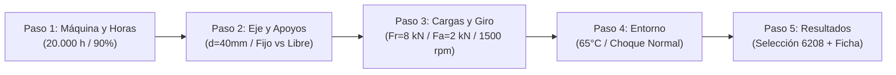

# CALIBRE — Guía Didáctica: Resolución de un Ejercicio Real Paso a Paso
### Cátedra: Mecánica II · Tecnicatura Universitaria en Mecatrónica (TUM)
**Tema:** Selección, verificación cinemática y vida a la fatiga de rodamientos (TP6 y TP7)

---

## 📌 1. Enunciado del Problema Real (Caso de Estudio)

Se desea seleccionar y verificar el rodamiento del **apoyo principal (Apoyo A)** del eje de salida de un reductor industrial que acciona un ventilador centrífugo de planta, con los siguientes datos obtenidos del análisis estático del eje:

| Variable | Valor | Significado técnico |
|---|---|---|
| **Diámetro del muñón del eje ($d$)** | **$40\text{ mm}$** | Diámetro interior requerido para el rodamiento |
| **Carga radial en el apoyo ($F_r$)** | **$8,0\text{ kN}$** | Reacción vertical/horizontal por flexión y peso |
| **Carga axial en el apoyo ($F_a$)** | **$2,0\text{ kN}$** | Empuje longitudinal generado por la transmisión |
| **Velocidad de giro ($n$)** | **$1.500\text{ r.p.m.}$** | Velocidad de rotación constante de servicio |
| **Vida requerida ($L_{h,\text{req}}$)** | **$20.000\text{ horas}$** | Servicio industrial en turnos (Tabla 9 ISO) |
| **Confiabilidad requerida** | **$90\%$ ($a_1 = 1,00$)** | Criterio estándar ISO 281 ($L_{10h}$) |
| **Condición del apoyo** | **Lado Fijo** | Ubica el eje axialmente en ambos sentidos |
| **Apoyo opuesto (Apoyo B)** | **Lado Libre** | Debe absorber la dilatación térmica $(\pm\Delta L)$ |
| **Temperatura de régimen** | **$65\text{ }^\circ\text{C}$** | Régimen térmico normal de marcha |
| **Severidad de choque** | **Normal** | Servicio industrial continuo con arranques suaves |

---

## 🖥️ 2. Flujo de Carga en la Aplicación (Paso a Paso)



---

### 🔹 PASO 1: Máquina y Vida Requerida
En la pestaña superior, ingresamos la categoría de la máquina y las horas objetivo.

```
┌─────────────────────────────────────────────────────────────────────────────────┐
│ PASO 1: APLICACIÓN Y VIDA REQUERIDA                                             │
├─────────────────────────────────────────────────────────────────────────────────┤
│ Tipo de máquina / Servicio:                                                     │
│ [ Industria 8 h (carga variable) - (10.000 a 25.000 h)                      ▼ ] │
│ Reductores generales, motores eléctricos estándar, trituradoras y molinos       │
│                                                                                 │
│ Horas requeridas de vida (L_req):         Confiabilidad requerida (ISO 281):    │
│ [ 20000            ] horas                [ 90% (Estándar L10, a1 = 1,00)   ▼ ] │
└─────────────────────────────────────────────────────────────────────────────────┘
```

> **Explicación para la clase:** La norma ISO 281 y el Catálogo SKF (Tabla 9, p. 83) estipulan que para máquinas de funcionamiento en 8 horas diarias de uso industrial general, la vida de diseño recomendada se sitúa entre 10.000 y 25.000 horas. Fijamos $20.000\text{ h}$ y confiabilidad estándar del 90% ($a_1 = 1$).

---

### 🔹 PASO 2: Eje y Disposición de Apoyos (Fijo y Libre)
Configuramos la cinemática del eje. El **Apoyo A** se define como **LADO FIJO** y el **Apoyo B** como **LADO LIBRE**.

```
┌─────────────────────────────────────────────────────────────────────────────────┐
│ PASO 2: GEOMETRÍA DEL EJE Y DISPOSICIÓN DE APOYOS                               │
├─────────────────────────────────────────────────────────────────────────────────┤
│ Diámetro de apoyo d: [ 40  ] mm       D máx: [ Sin restricción ]                │
│                                                                                 │
│ CONFIGURACIÓN CINEMÁTICA DE APOYOS (ISO Catálogo p. 55):                        │
│ ┌───────────────────────────────┐     ┌───────────────────────────────┐         │
│ │ Apoyo A (Lado Izquierdo):     │     │ Apoyo B (Lado Derecho):       │         │
│ │ [ ● LADO FIJO ] [ Lado Libre ]│     │ [ Lado Fijo ] [ ● LADO LIBRE ]│         │
│ └───────────────────────────────┘     └───────────────────────────────┘         │
│ [X] Permitir aro exterior holgado en apoyo libre (dilatación térmica)           │
└─────────────────────────────────────────────────────────────────────────────────┘
```

> **Visualización en el Croquis:** Notar cómo en la pantalla superior, el croquis vectorial SVG dibuja automáticamente los topes axiales dorados en el Apoyo A y las flechas verdes bidireccionales con la cota **$\pm\Delta L\text{ DILATACIÓN}$** en el Apoyo B.

---

### 🔹 PASO 3: Cargas Aplicadas y Velocidad
Cargamos las fuerzas que calculamos previamente en la estática del eje.

```
┌─────────────────────────────────────────────────────────────────────────────────┐
│ PASO 3: CARGAS APLICADAS Y VELOCIDAD                                            │
├─────────────────────────────────────────────────────────────────────────────────┤
│ Carga radial Fr (kN):       Carga axial Fa (kN):        Velocidad n (r.p.m.):   │
│ [ 8.0               ]       [ 2.0               ]       [ 1500              ]   │
│                                                                                 │
│ Nivel de choques:           [ Normal (Choques moderados industriales)       ▼ ] │
│ [ ] El empuje axial invierte su sentido periódicamente                          │
└─────────────────────────────────────────────────────────────────────────────────┘
```

> **Verificación visual:** En el croquis del eje aparece de inmediato el vector vertical rojo descendente con su cápsula **`Fr = 8.0 kN`** y el vector horizontal cobrizo con su cápsula **`Fa = 2.0 kN`**, perfectamente posicionados sin taparse entre sí.

---

### 🔹 PASO 4: Entorno de Trabajo
Ajustamos las condiciones de servicio real de planta.

```
┌─────────────────────────────────────────────────────────────────────────────────┐
│ PASO 4: ENTORNO Y REQUISITOS ESPECIALES                                         │
├─────────────────────────────────────────────────────────────────────────────────┤
│ Desalineación angular:      [ Sin flexión / Alineación rígida (< 2 min)     ▼ ] │
│ Temperatura de régimen:     [ 65 ] °C  (Estándar admite hasta 120 °C)           │
│ Nivel de contaminación:     [ Limpieza normal (Placas Z / filtro fino)      ▼ ] │
│ Exigencia de silencio:      [ Normal industrial                             ▼ ] │
│ Exigencia de rigidez:       [ Normal                                        ▼ ] │
└─────────────────────────────────────────────────────────────────────────────────┘
```

---

### 🔹 PASO 5: Resultados del Ranking y Selección Óptima
La aplicación evalúa todas las familias y filtra los tamaños disponibles en catálogo para $d = 40\text{ mm}$.

```
┌─────────────────────────────────────────────────────────────────────────────────┐
│ PASO 5: RESULTADOS DEL CÁLCULO                                                  │
├─────────────────────────────────────────────────────────────────────────────────┤
│ Disposición: Apoyo fijo: fija axialmente en ambos sentidos.                     │
│ Capacidad dinámica mínima requerida calculada: C_req = 10,75 kN                 │
│                                                                                 │
│ 🥇 CANDIDATO RECOMENDADO:                                                       │
│ ┌─────────────────────────────────────────────────────────────────────────────┐ │
│ │ [SECCIÓN CAD]   6208                  [ CUMPLE ]   [ Muestra ]              │ │
│ │                 40 × 80 × 18 mm  ·  C = 32,5 kN  ·  C0 = 19,0 kN            │ │
│ │                                                                             │ │
│ │ Vida Nominal L10h: 74.436 h   ·   Seguridad s0: 2,38   ·   Uso vel: 16%     │ │
│ │                                                                             │ │
│ │ Motivo: "Cumple la vida requerida de 20.000 h con un margen de 3.7x"        │ │
│ │ Acciones: [ Ficha de cálculo ]   [ Comparar ]                               │ │
│ └─────────────────────────────────────────────────────────────────────────────┘ │
│                                                                                 │
│ 🥈 ALTERNATIVA: 6308 (40 × 90 × 23 mm · C = 42,3 kN · L10h = 163.500 h)         │
│    (Se descarta como primera opción por exceso de masa y dimensiones: 6208 es │ │
│    la más económica y estándar de reposición en plaza).                         │
└─────────────────────────────────────────────────────────────────────────────────┘
```

---

## 📐 3. Memoria de Cálculo Detallada (Lo que muestra la "Ficha de Cálculo")

Al presionar **"Ficha de cálculo"**, la aplicación expone la auditoría matemática que valida el resultado frente a la cátedra:

### 1. Determinación de la Carga Dinámica Equivalente ($P$)
* Relación de solicitación:
  $$\frac{F_a}{F_r} = \frac{2,0\text{ kN}}{8,0\text{ kN}} = 0,250$$
* Factor de carga axial para rodamiento rígido de bolas (Tabla 8 SKF / ISO 281):
  $$\frac{f_0 \cdot F_a}{C_0} = \frac{14 \cdot 2,0}{19,0} = 1,47$$
* Interpolando en la Tabla 8 para juego normal (CN):
  $$e \approx 0,31$$
* **Criterio de decisión:**
  $$\frac{F_a}{F_r} = 0,250 \le e = 0,31 \implies P = F_r = \mathbf{8,00\text{ kN}}$$
  *(El rodamiento absorbe el empuje axial por el fondo de garganta sin que las bolas se monten en el hombro de la pista).*

---

### 2. Cálculo de la Vida Nominal a la Fatiga ($L_{10}$ y $L_{10h}$)
* Exponente para elementos rodantes esféricos (bolas): $p = 3$.
* Vida en millones de revoluciones:
  $$L_{10} = \left(\frac{C}{P}\right)^3 = \left(\frac{32,5\text{ kN}}{8,0\text{ kN}}\right)^3 = (4,0625)^3 = \mathbf{66,99\text{ millones de revoluciones}}$$
* Vida nominal en horas de funcionamiento continuo a $n = 1.500\text{ r.p.m.}$:
  $$L_{10h} = \frac{10^6}{60 \cdot n} \cdot L_{10} = \frac{10^6}{60 \cdot 1.500} \cdot 66,99 = \mathbf{74.436\text{ horas}}$$
* **Conclusión de fatiga:** Como $74.436\text{ h} \ge 20.000\text{ h}$ requeridas, el rodamiento cumple con un factor de seguridad a la fatiga de **$3,72\times$**.

---

### 3. Verificación de Seguridad Estática ($s_0$ según ISO 76)
* Carga estática equivalente:
  $$P_0 = \max\left(F_r;\; 0,6 F_r + 0,5 F_a\right) = \max\left(8,0;\; 0,6 \cdot 8,0 + 0,5 \cdot 2,0\right) = \max(8,0;\; 5,8) = \mathbf{8,00\text{ kN}}$$
* Coeficiente de seguridad estática:
  $$s_0 = \frac{C_0}{P_0} = \frac{19,0\text{ kN}}{8,0\text{ kN}} = \mathbf{2,38}$$
* **Criterio ISO 76 (Tabla 11):** Para rodamiento en rotación, con exigencia normal y choques moderados, se exige $s_0 \ge 1,0$. Como $2,38 \ge 1,0$, **no hay riesgo de deformación plástica permanente ni marcación de pistas**.

---

### 4. Verificación de Carga Axial Máxima Admisible
* En rígidos de bolas de una hilera serie 62 ($d = 40\text{ mm}$), la carga axial pura admisible tiene como límite:
  $$F_{a,\text{máx}} \le 0,5 \cdot C_0 = 0,5 \cdot 19,0\text{ kN} = 9,5\text{ kN}$$
* Como $F_a = 2,0\text{ kN} \ll 9,5\text{ kN}$, la carga está ampliamente dentro del rango seguro.

---

### 5. Verificación de Régimen de Velocidad
* Velocidad de trabajo: $n = 1.500\text{ r.p.m.}$
* Velocidad mecánica límite de catálogo: $n_{\text{lim}} = 9.500\text{ r.p.m.}$
* Porcentaje de utilización del límite:
  $$\frac{1.500}{9.500} \times 100\% = \mathbf{15,8\%} \quad (\text{Régimen holgado, sin riesgo térmico})$$

---

## 🖨️ 4. Generación del Informe de Ingeniería
Al presionar el botón **"Informe"**, la aplicación genera automáticamente la memoria técnica imprimible formal (A4 en fondo claro) que contiene:
1. Encabezado con versión auditada del motor (`ENGINE v1.0.0`) y fecha.
2. Parámetros de diseño tabulados.
3. Croquis cinemático del eje con acotación de apoyos y vectores de fuerza.
4. Dictamen técnico de aprobación.
5. Pie legal de alcance y responsabilidad técnica conforme a normas internacionales.
